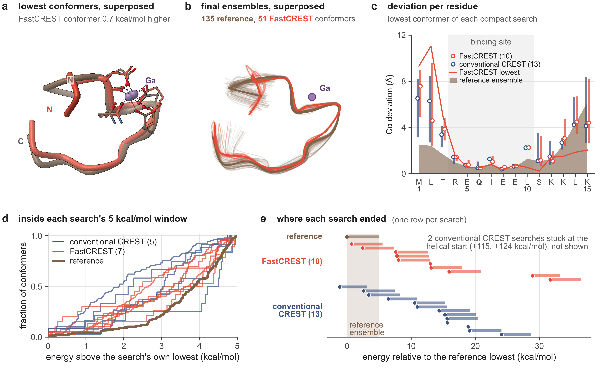
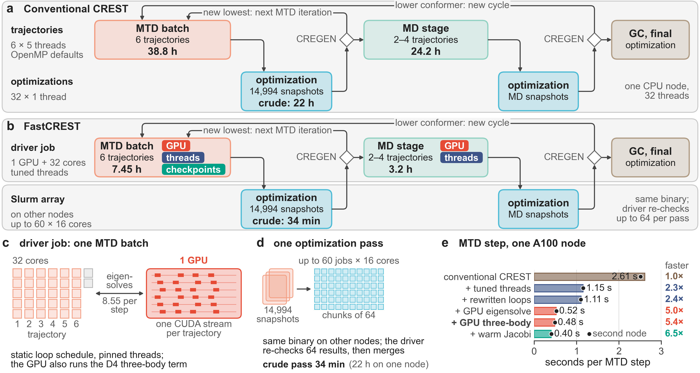

# FastCREST: GPU-accelerated CREST conformer searches with unchanged energies and gradients

Supantha Dey<sup>1,2</sup>, Nilusha Kariyawasam<sup>1</sup> and Ratul Chowdhury<sup>1,\*</sup>

<sup>1</sup> Department of Chemical and Biological Engineering, Iowa State University, Ames, Iowa 50011, USA  
<sup>2</sup> Interdepartmental Genetics and Genomics Program, Iowa State University, Ames, Iowa 50011, USA  
<sup>\*</sup> Corresponding author: [ratul@iastate.edu](mailto:ratul@iastate.edu)

*Manuscript in preparation. Markdown version of the PDF; figures as PNG.*

## Abstract

CREST conformer searches with GFN2-xTB are slow for large, flexible molecules: one conventional CREST search of a 274-atom gallium peptide took 321.5 h on 32 CPU threads. FastCREST keeps CREST’s method and settings and changes how a search uses the hardware: it runs the metadynamics and molecular dynamics (MD) trajectories with a static OpenMP schedule, pinned threads and one GPU for the self-consistent-charge (SCC) eigensolve and the D4 three-body dispersion term, sends the roughly 15,000 geometry optimizations of each iteration to Slurm array jobs on CPU nodes, and checkpoints the metadynamics loop. From the same input, on different hardware, a FastCREST search took 54.3 h instead of 321.5 h and made 1.37 times as many energy-and-gradient (E/G) calls, so its throughput was 8.1 times higher. On one A100 node, the thread settings and rewritten loops made each metadynamics time step 2.4 times faster and the GPU another 2.3 times, and worker jobs cut a pass of 15,000 optimizations from about 22 h to 34 min. Per million calls FastCREST used 1,231 allocated CPU-hours plus 7.5 GPU-hours, against at least 1,939 CPU-hours for the 321.5 h search. Energies match the CREST 3.0.2 release within 1.01 × 10⁻¹⁰ Eₕ and gradients within 8.2 × 10⁻¹¹ Eₕ bohr⁻¹, and short MD runs pass a pre-specified equivalence test. Replicate FastCREST and conventional CREST searches end in similar compact conformers with no detectable energy difference, although too few searches ran to show equivalence; outside the Ga site, which CREST’s topology check holds fixed, both differ from the 321.5 h search mainly at the peptide termini. Code: <https://github.com/chowdhurylab-studio/fastCREST>.

## 1 Introduction

CREST with GFN2-xTB is a standard tool for generating conformer ensembles [1–4]. Each energy-and-gradient (E/G) call is cheap, but a search makes millions of them. One conventional CREST search (`--quick`) of a 274-atom gallium peptide with charge +4 in implicit water (ALPB [5]; Figure 1), which we call the reference search, took 321.5 h (13.4 days) on 32 CPU threads. Even with tuned thread settings, 64 instead of 32 threads cut the time per metadynamics (MTD) step [6] by only 6 to 9%.

A CREST search mixes a few long trajectories, limited by the latency of a single E/G call, with many thousands of independent geometry optimizations, and conventional CREST runs both on the threads of one node (Figure 2a). GPU codes for semiempirical and tight-binding methods [7–11] accelerate single calculations, not this mix. FastCREST therefore changes how the whole search runs (Figure 2b): the trajectories get tuned threads and one GPU, each worth a factor of 2.2 to 2.4 per MTD step; the optimizations go to Slurm array jobs on other CPU nodes; and checkpoints let a search use preemptible GPUs on a shared cluster. We allowed only changes that keep the computation the same up to floating-point order and self-consistent-charge (SCC) convergence. FastCREST searches end in the same kind of compact structures as the reference search (Section 5).



**Figure 1.** Final conformers of the reference search (brown) and of our replicate FastCREST (red) and conventional CREST searches (navy); numbers in parentheses count searches. (a–c) Structures superposed on the binding site (Ga, Cδ of Glu5, Gln6, Glu8 and Glu9, and the backbone of residues 4–10). (a) Lowest conformers (FastCREST: best of ten searches); tubes trace the Cα atoms, dashes join Ga to oxygens within 2.6 Å. (b) Cα traces of all final conformers, the lowest in bold. (c) Per-residue Cα deviation from the reference lowest conformer, for the lowest conformer of each compact search: medians (circles) and interquartile ranges (bars), the FastCREST conformer of (a) (line), and the largest deviation within the reference ensemble (shaded). Bold residues bind Ga. (d) Cumulative fraction of conformers against the energy above the search’s own lowest conformer, for ensembles with at least 10 conformers. (e) One row per compact search: its lowest conformer (dot) and the energy range of its final conformers (bar), relative to the reference lowest conformer; shading marks the reference ensemble.

## 2 FastCREST

In CREST’s iMTD-GC workflow (iterative metadynamics with genetic crossing; Figure 2a) [1, 3], each iteration runs six RMSD-biased MTD trajectories at once and optimizes their roughly 15,000 snapshots, crude and then regular, sorting them with CREGEN; iterations repeat while they find a new lowest conformer, and a molecular dynamics (MD) stage and genetic crossing follow. The reference search, an earlier production run by one of us (N.K.), used the CREST 3.0.2 release [12] on 32 threads with OpenMP defaults, on a node type that was not recorded, and spent 48.2% of its 321.5 h in MTD, 36.7% in optimizations and 15.0% in MD.

FastCREST is CREST commit cfdc301f [13], 80 commits after the release, built with tblite 0.5.0 [14] and patched as described below. Of those commits, only one can change results: unconverged ANCOPT optimizations now stop after 200 cycles, which left 2 to 3 more of every 100 MD frames unconverged than the release, above our preset limit of 1 (Table 2). We kept it, because structures that converged in both builds got the same topology-check result and controlled MD against the release passed (Section 4). We call our build without patches the *unmodified build*. *FastCREST* searches run the patched build with its GPU code on. *Conventional CREST* searches have no GPU code: the reference search, and our replicates with the unmodified build or the FastCREST binary with its GPU code off, two binaries with bitwise identical single-thread results. All replicates used the thread settings below, and most the distributed optimizations; neither changes the computation.

**Threads and loops.** CREST runs the six trajectories of an MTD batch at once with five threads each (nested OpenMP) and optimizations with one thread each. With OpenMP defaults, tblite’s parallel loops hand out one iteration at a time, and five threads computed an E/G call no faster than one (2.59 against 2.57 s; 1.34 s with a static schedule). FastCREST’s environment script sets a static schedule, pins each trajectory’s threads to neighboring cores and enlarges glibc’s thread-stack cache. With the same binary, MTD steps ran 2.2 to 2.3 times faster than with the reference search’s settings on two A100 nodes (Figure 2e) and on CPU-only EPYC 7502 nodes, where MD steps ran 2.0 to 2.5 times faster; optimizations did not change. In tblite and its dependencies, we rewrote 43 statements that built 3 × 3 outer products with the Fortran intrinsic `spread`, which allocates temporaries in inner loops, as explicit loops with the same operand order; compiled without fused multiply–add, they round exactly as before.

**One GPU for the trajectories.** Each SCC iteration solves the generalized eigenproblem $`\mathbf{H}[\mathbf{P}]\,\mathbf{C} = \mathbf{S}\,\mathbf{C}\,\boldsymbol{\varepsilon}`$, with $`\mathbf{P} = \mathbf{C}\,\mathrm{diag}(\mathbf{n})\,\mathbf{C}^{\mathsf{T}}`$, where the Hamiltonian $`\mathbf{H}`$ depends on the density matrix $`\mathbf{P}`$, $`\mathbf{S}`$ is the overlap matrix, $`\mathbf{C}`$ the orbital coefficients, $`\boldsymbol{\varepsilon}`$ the orbital energies and $`\mathbf{n}`$ the Fermi-smeared occupations. Here the matrices are 671 × 671, with 8.55 solves per MD step. During MTD and MD, cuSOLVER’s FP64 `dsygvd` [15] solves it and cuBLAS [16] forms $`\mathbf{P}`$, with one CUDA stream per trajectory. A deterministic FP64 kernel evaluates the D4 three-body (Axilrod–Teller–Muto) term [17–19],

```math
E^{(3)} = \sum_{A<B<C} C_9^{ABC}\, f_\mathrm{damp}\,
\frac{3\cos\theta_A\cos\theta_B\cos\theta_C + 1}{(r_{AB}\,r_{BC}\,r_{CA})^3}, \tag{1}
```

with interatomic distances *r*, the interior angles θ of each atom triangle, $`C_9^{ABC} = 5\,(C_6^{AB} C_6^{BC} C_6^{CA})^{1/2}`$ from zero-charge C₆ coefficients, and the GFN2-xTB damping $`f_\mathrm{damp}`$ [4]. It is evaluated once per E/G call over up to 3.4 million triples and reproduces the CPU gradient within 4.4 × 10⁻¹⁸ Eₕ bohr⁻¹. Optimizations stay on the CPU: 32 optimizations sharing one GPU ran at only 0.87 to 0.89 times the CPU rate, and CPU results can be checked bit for bit.

**Distributed optimizations and checkpoints.** The driver job sends each optimization pass of 128 or more structures to one Slurm job array [20] in chunks of 64, and the workers run the same binary. Before merging, the driver re-optimizes up to 32 structures from workers with its own CPU model, which must agree bitwise, and up to 32 from workers with other CPU models, which must agree within 10⁻⁷ Eₕ in energy and 10⁻⁴ Å in coordinates; any mismatch reruns the pass or the affected chunks. Each trajectory writes an exact checkpoint every 40 steps and each optimized structure is journaled, so a search preempted during the MTD loop resumes from its last checkpoint; the MD stage after the loop restarts from its beginning. With checkpoints on, each trajectory starts its first SCC from a fresh guess, the only change in behavior apart from floating-point order. We did not test whether resumed searches are statistically equivalent to uninterrupted ones.

**Jacobi variant.** An optional build starts cuSOLVER’s Jacobi eigensolver (`syevj`) from the previous SCC iteration’s eigenvectors and reuses the overlap matrix’s Cholesky factor within each E/G call, which made MTD steps 1.2 times faster (Figure 2e). It matched FastCREST’s single-point energy within 1.1 × 10⁻¹³ Eₕ and the standard solver’s eigenvalues within 7.6 × 10⁻¹⁵ Eₕ, with no fallback in 133,158 solves. We did not release it, because each solve depends on the previous one.



**Figure 2.** The same iMTD-GC workflow in conventional CREST (a) and FastCREST (b), how FastCREST runs it (c, d) and what each change gives (e). Times per step come from the reference search (a) and the FastCREST search of Table 1 (b; crude pass from the GPU-eigensolve-only search, which has the same CPU code). (c) Each trajectory of an MTD batch runs on five pinned cores of the driver job and sends its SCC eigensolves to one GPU through its own CUDA stream. (d) Optimization passes run as Slurm array jobs on other nodes; the driver re-checks 64 results before merging. (e) Time per MTD step on one A100 node (EPYC 7543 host, 32 cores), each change added in turn: one six-trajectory batch per configuration, mean of two runs (bars), and the same on a second A100 node (dots).

## 3 Performance

Searches adapt their length, so we compare the E/G throughput $`R = N/t_\mathrm{wall}`$ and the allocated cost per call, $`K_\mathrm{CPU} = N^{-1}\sum_j c_j t_j`$ and $`K_\mathrm{GPU} = N^{-1}\sum_j g_j t_j`$, where *N* counts the E/G calls of the driver and all workers, $`t_\mathrm{wall}`$ is the driver’s elapsed time, and job $`j`$ was allocated $`c_j`$ hardware threads and $`g_j`$ GPUs for its elapsed time $`t_j`$. In Table 1, the FastCREST search found a lower conformer twice, so it ran three cycles instead of two and made 1.37 times as many calls. It took 54.3 h, so its throughput was 8.1 times that of the reference search (R/R₀ = 8.1). Per million calls it used 1,231 CPU-hours plus 7.5 GPU-hours, against at least 1,939 CPU-hours, so it is cheaper whenever a GPU-hour costs less than about 94 hardware-thread-hours (47 core-hours). Without a GPU, searches with the thread settings, two of them also with the distributed optimizations, reached 3.3 to 4.7 times the reference throughput.

Figure 2e adds the changes one at a time on one A100 node (EPYC 7543 host, 32 cores). Conventional CREST took 2.61 s per MTD step there (2.8 s in the reference search). The thread settings and rewritten loops cut this to 1.11 s, a factor of 2.4, and the GPU eigensolve and three-body term to 0.48 s, another factor of 2.3, so FastCREST’s step was 5.4 times faster on the same node (5.1 on a second A100 node); the Jacobi variant reached 0.40 s. Each step is still mostly host work (63.5% in an early profile), but six trajectories kept the GPU 83 to 86% busy, and a second GPU per search gained only a factor of 1.19. Optimizations fell from 36.7% to 13.6% of the run, so the trajectories now take 86% of it. No single change gives the factor of 8.1.

**Table 1.** Complete searches from the same input and settings, one run each: MTD iterations and MD stages, elapsed time of the driver job, E/G calls *N*, throughput R/R₀ relative to the reference search, and allocated CPU- and GPU-hours per million calls ($`K_\mathrm{CPU}`$, $`K_\mathrm{GPU}`$; Section 3). All but the first two searches sent their optimization passes to Slurm CPU workers on other nodes.

| Search | Driver hardware | MTD/MD | Wall (h) | *N* (10⁶) | R/R₀ | CPU-h per 10⁶ E/G | GPU-h per 10⁶ E/G |
|:---|:---|:---|:---|:---|:---|:---|:---|
| Conventional CREST<sup>a</sup> | not recorded | 4/2 | 321.5 | 5.31 | 1.00 | 1,939 | 0 |
| Tuned CPU node<sup>b</sup> | Zen 4, 64 cores | 4/2 | 100.3 | 5.50 | 3.32 | 2,334 | 0 |
| Distributed, earlier build<sup>c</sup> | Zen 4 | 4/3 | 98.7 | 6.17 | 3.79 | 2,851 | 0 |
| FastCREST binary, GPU off<sup>d</sup> | Zen 5 | 2/1 | 33.8 | 2.62 | 4.71 | 2,255 | 0 |
| GPU eigensolve only<sup>e</sup> | A100, EPYC 7502 | 4/2 | 52.0 | 5.38 | 6.28 | 1,574 | 9.7 |
| **FastCREST**<sup>f</sup> | A100, EPYC 7543 | 5/3 | 54.3 | 7.26 | 8.11 | 1,231 | 7.5 |
| Jacobi variant<sup>g</sup> | A100, EPYC 7543 | 4/3 | 36.9 | 5.77 | 9.48 | 1,194 | 6.4 |

<sup>a</sup> The reference search: CREST 3.0.2 release, OpenMP defaults; CPU-hours are 32 threads × wall time, not a recorded allocation (whole cores would double them). <sup>b</sup> Rewritten loops and thread settings, one node. <sup>c</sup> Distributed passes and checkpoints, without the rewritten loops. <sup>d</sup> One cycle; a conventional CREST replicate. <sup>e</sup> No rewritten loops; three-body term on the CPU. <sup>f</sup> All changes of Section 2, one NVIDIA A100. <sup>g</sup> FastCREST with the Jacobi eigensolve of Section 2; not released. CPU types: EPYC 7502 is AMD Zen 2, EPYC 7543 Zen 3.

## 4 Same computation

Table 2 summarizes the tests, which covered the release, the unmodified build, and FastCREST and its Jacobi variant on CPU and GPU. Single points on 306 structures agreed with the release within 1.01 × 10⁻¹⁰ Eₕ in energy and 8.2 × 10⁻¹¹ Eₕ bohr⁻¹ in gradient, two orders of magnitude inside our criterion, and FastCREST’s GPU and CPU routes differed by at most 4 × 10⁻¹³ Eₕ.

Trajectories cannot be compared bit for bit, because multithreaded reductions are not reproducible [21]: even two runs of the same binary separated by 0.5 Å (all-atom RMSD) after a median of 6.5 ps. We therefore ran controlled MD, 20 ps from four starts at 400 and 500 K with identical initial velocities, and compared the fraction of frames whose bonding topology changed. Two configurations count as equivalent if the paired 90% confidence interval of the mean difference over 24 or 44 trajectory pairs lies within ±0.15 (two one-sided tests [22]); all nine comparisons passed.

Whole searches are not reproducible either. Thirteen of the 15 finished conventional CREST replicates ended between −1.1 and +24.1 kcal/mol relative to the reference search, with 1 to 82 conformers; the other two ended more than 110 kcal/mol higher because of a fallback in CREST itself (Section 5). We therefore compared groups at a common endpoint, the lowest crude-level energy after the first MTD iteration. The 16 FastCREST endpoints were typically 4.1 kcal/mol higher than the 17 conventional CREST ones (Hodges–Lehmann shift [23, 24], 95% CI −4.9 to +11.8 kcal/mol). No difference was detected, but a FastCREST disadvantage of up to 11.8 kcal/mol cannot be excluded, and showing equivalence within our ±2 kcal/mol margin would need more than a hundred searches per group. Final energies agree with this (FastCREST median +10.5, conventional CREST median +15.3 kcal/mol; post hoc shift −2.7 kcal/mol, 95% CI −11.3 to +6.5). The evidence that the computation is unchanged therefore rests on the code-level tests.

**Table 2.** Tests that FastCREST reproduces the computation of unmodified CREST (the release and the unmodified build). Criteria were fixed before the runs, except the replicate decision rule, which was fixed after some individual results had been seen but before any group statistic was computed.

| Test | Compared | Criterion | Result |
|:---|:---|:---|:---|
| Startup parameters | six configurations | same parameters | same (flexibility 0.391, six 250 ps MTD runs, 272 SHAKE bonds) |
| Single points | 306 structures, seven configurations | max \|ΔE\| ≤ 10⁻⁸ Eₕ, max gradient difference ≤ 10⁻⁶ Eₕ bohr⁻¹ | 1.01 × 10⁻¹⁰ Eₕ and 8.2 × 10⁻¹¹ Eₕ bohr⁻¹ from the release |
| ANCOPT cap (upstream) | 200 MD frames, our builds vs release | at most 1 more unconverged per 100 | 2 to 3 more per 100: threshold exceeded; kept (Section 2) |
| Controlled MD | 9 comparisons, 24 or 44 trajectory pairs each | 90% CI of the mean difference within ±0.15 | all 9 equivalent, in raw frames and after optimization |
| Replicate searches | endpoint energy, 16 FastCREST vs 17 conventional CREST searches | difference: 95% CI excludes 0; equivalence: 90% CI within ±2 kcal/mol | inconclusive: shift +4.1 kcal/mol, 95% CI −4.9 to +11.8 |
| Released code | clean clone, rebuilt | output byte-identical; test script passes | byte-identical; 5 of 5 tests passed |

## 5 Structures

Every search started from the same helical structure, in which Ga³⁺ binds five oxygens: the backbone carbonyl and carboxylate of Glu5, the amide of Gln6 and the carboxylates of Glu8 and Glu9. CREST’s topology check keeps only structures with the input’s bonds, so every final conformer keeps these five Ga–O bonds; with structures superposed on the binding site, agreement there is expected, and the informative comparison is the rest of the peptide. The reference search ended 136.2 kcal/mol below the input, in a compact conformer (radius of gyration 6.33 instead of 7.56 Å) in which the helix has unfolded and the second Glu8 oxygen sits 2.40 Å from Ga, a contact that the topology check does not count as a bond. These energies and the preference for compact folds are GFN2-xTB/ALPB results that we did not validate further.

Of the 27 finished searches (the reference, 10 FastCREST, 15 conventional CREST replicates and the Jacobi variant), all but two conventional CREST replicates ended compact. In those two, the regular optimization of one MTD iteration changed the bonding topology of every structure in the energy window, and CREST’s ensemble sorter fell back to the helical input (code in `cregen.f90` that is identical in the 3.0.2 release). The lowest FastCREST conformer (best of ten searches) lies 0.7 kcal/mol above the reference lowest and has the same Glu8 contact (2.33 Å). Superposed on the binding site [25] (Figure 1a), the two coincide within 2.1 Å from Arg4 to Lys15; only Met1 to Thr3 point elsewhere, and the two final ensembles overlap in the same way (Figure 1b). No other search found the reference lowest conformer: the lowest conformers of the other compact searches lie 1.4 to 4.1 Å (backbone RMSD) from it, whereas all 135 reference conformers lie within 1.4 Å. FastCREST and conventional CREST replicates deviate from it in the same places (Figure 1c): their median Cα deviations agree within 0.5 Å at every residue except Met1 and Leu2.

The energies tell the same story. Ensemble sizes vary as widely (FastCREST 1 to 173 conformers, conventional CREST 1 to 82, reference 135), because each keeps only its last cycle’s conformers within 5 kcal/mol of its own lowest. Within that window, FastCREST and conventional CREST ensembles distribute their conformers alike, and the reference ensemble, with most conformers 3 to 5 kcal/mol above its lowest, lies at the edge of both (Figure 1d). On one scale, FastCREST searches scatter as widely as conventional CREST ones (lowest conformers +0.7 to +31.7 against −1.1 to +24.1 kcal/mol), and only 2 of the 10 FastCREST and 3 of the 13 conventional CREST ensembles overlap the energy range of the reference one (Figure 1e). Where a search ends up depends on the search, not on the code.

## 6 Discussion

Further speedup must come from the MTD step itself: fewer or cheaper SCC solves, or moving the remaining host work to the GPU. Caching the overlap factorization alone, sharing idle threads between trajectories, batching eigensolves in the optimizations, other compiler flags and Intel MKL gave little or no gain, and density-matrix purification would change the algorithm.

**Limitations.** All results come from one system with `--quick`; speedups for other molecules will depend on the host CPU, the GPU and the system size. Each complete search in Table 1 ran once. The replicate groups ran under different conditions. Of 40 FastCREST replicates started, 16 reached the endpoint: an uncorrectable memory error on one GPU stopped the resumed jobs of 17 at startup, and after seeing interim results we did not resubmit them; the other 7 were canceled early or still queued. Thirteen of the 16 FastCREST searches, but 7 of the 17 conventional CREST ones, resumed from checkpoints before the endpoint; 12 of the 16 finished their first iteration on L40S or V100 GPUs, which the code-level tests did not cover, and 6 computed the three-body term on the CPU in at least part of the run. Resuming from the fourth MTD batch on can fail (three conventional CREST replicates after the endpoint, one FastCREST search after our data cutoff). In single Cu and Ni searches of a related peptide, most MTD trajectories stopped early with these settings, as in Fe searches with the release; we cannot tell whether our build plays a part.

## 7 Software and data

FastCREST (<https://github.com/chowdhurylab-studio/fastCREST>, version 1.0.6, which differs from the tested 1.0.0 only in comments and documentation) consists of patches to CREST cfdc301f [13], tblite [14], dftd4 [26], simple-dftd3 [27], multicharge [28] and mctc-lib [29], each under the license of the code it patches. The repository also holds a build script that fetches the pinned upstream commits, the thread-settings script, Slurm job templates and a test script. With its TOML keyword and environment variables unset, single-thread energies and gradients are bitwise identical to those of an unmodified build. A clean build from GitHub reproduced the single-point output of the binary used here byte for byte and passed the test script (Table 2). The peptide input, the final ensembles and the raw outputs are available from the authors on request.

**Acknowledgments.** We thank Mahbuba Ferdaous for the structures of the open-shell metal complexes of the related peptide and Iowa State University Research IT for access to the Nova cluster. [Funding to be added.]

## References

1. Philipp Pracht, Fabian Bohle, and Stefan Grimme. Automated exploration of the low-energy chemical space with fast quantum chemical methods. *Phys. Chem. Chem. Phys.*, 22: 7169–7192, 2020. [doi:10.1039/C9CP06869D](https://doi.org/10.1039/C9CP06869D).
2. Philipp Pracht, Stefan Grimme, Christoph Bannwarth, Fabian Bohle, Sebastian Ehlert, Gereon Feldmann, Johannes Gorges, Marcel Müller, Tim Neudecker, Christoph Plett, Sebastian Spicher, Pit Steinbach, Patryk A. Wesołowski, and Felix Zeller. CREST—A program for the exploration of low-energy molecular chemical space. *J. Chem. Phys.*, 160: 114110, 2024. [doi:10.1063/5.0197592](https://doi.org/10.1063/5.0197592).
3. Stefan Grimme. Exploration of chemical compound, conformer, and reaction space with meta-dynamics simulations based on tight-binding quantum chemical calculations. *J. Chem. Theory Comput.*, 15: 2847–2862, 2019. [doi:10.1021/acs.jctc.9b00143](https://doi.org/10.1021/acs.jctc.9b00143).
4. Christoph Bannwarth, Sebastian Ehlert, and Stefan Grimme. GFN2-xTB—An accurate and broadly parametrized self-consistent tight-binding quantum chemical method with multipole electrostatics and density-dependent dispersion contributions. *J. Chem. Theory Comput.*, 15: 1652–1671, 2019. [doi:10.1021/acs.jctc.8b01176](https://doi.org/10.1021/acs.jctc.8b01176).
5. Sebastian Ehlert, Marcel Stahn, Sebastian Spicher, and Stefan Grimme. Robust and efficient implicit solvation model for fast semiempirical methods. *J. Chem. Theory Comput.*, 17: 4250–4261, 2021. [doi:10.1021/acs.jctc.1c00471](https://doi.org/10.1021/acs.jctc.1c00471).
6. Alessandro Laio and Michele Parrinello. Escaping free-energy minima. *Proc. Natl. Acad. Sci. U.S.A.*, 99: 12562–12566, 2002. [doi:10.1073/pnas.202427399](https://doi.org/10.1073/pnas.202427399).
7. Xin Wu, Axel Koslowski, and Walter Thiel. Semiempirical quantum chemical calculations accelerated on a hybrid multicore CPU–GPU computing platform. *J. Chem. Theory Comput.*, 8: 2272–2281, 2012. [doi:10.1021/ct3001798](https://doi.org/10.1021/ct3001798).
8. Julio Daniel Carvalho Maia, Gabriel Aires Urquiza Carvalho, Carlos Peixoto Mangueira, Sidney Ramos Santana, Lucidio Anjos Formiga Cabral, and Gerd B. Rocha. GPU linear algebra libraries and GPGPU programming for accelerating MOPAC semiempirical quantum chemistry calculations. *J. Chem. Theory Comput.*, 8: 3072–3081, 2012. [doi:10.1021/ct3004645](https://doi.org/10.1021/ct3004645).
9. Guoqing Zhou, Ben Nebgen, Nicholas Lubbers, Walter Malone, Anders M. N. Niklasson, and Sergei Tretiak. Graphics processing unit-accelerated semiempirical Born Oppenheimer molecular dynamics using PyTorch. *J. Chem. Theory Comput.*, 16: 4951–4962, 2020. [doi:10.1021/acs.jctc.0c00243](https://doi.org/10.1021/acs.jctc.0c00243).
10. Van-Quan Vuong, Caterina Cevallos, Ben Hourahine, Bálint Aradi, Jacek Jakowski, Stephan Irle, and Cristopher Camacho. Accelerating the density-functional tight-binding method using graphical processing units. *J. Chem. Phys.*, 158: 084802, 2023. [doi:10.1063/5.0130797](https://doi.org/10.1063/5.0130797).
11. Marvin Friede, Christian Hölzer, Sebastian Ehlert, and Stefan Grimme. dxtb—An efficient and fully differentiable framework for extended tight-binding. *J. Chem. Phys.*, 161: 062501, 2024. [doi:10.1063/5.0216715](https://doi.org/10.1063/5.0216715).
12. Philipp Pracht et al. CREST: Conformer–Rotamer Ensemble Sampling Tool, version 3.0.2. <https://github.com/crest-lab/crest/releases/tag/v3.0.2>, 2024. Software release of 2024-08-25 (tag v3.0.2, commit af7eb99), run as the conda-forge build crest-3.0.2-h8876d29_1; LGPL-3.0-or-later.
13. Philipp Pracht et al. CREST: Conformer–Rotamer Ensemble Sampling Tool, commit cfdc301f. <https://github.com/crest-lab/crest/tree/cfdc301f759686b0fd66ced63b5ddbd6c693fa4f>, 2026. Software; master branch, commit of 2026-06-16, 80 commits after v3.0.2; LGPL-3.0-or-later.
14. Sebastian Ehlert. tblite: Light-weight tight-binding framework, version 0.5.0. <https://github.com/tblite/tblite/releases/tag/v0.5.0>, 2025. Software; commit 6f6cd7d, the tblite submodule of CREST cfdc301f; LGPL-3.0-or-later.
15. NVIDIA Corporation. cuSOLVER library, CUDA toolkit 12.4.1 documentation. <https://docs.nvidia.com/cuda/archive/12.4.1/cusolver/index.html>, 2024. Accessed 2026-10-26.
16. NVIDIA Corporation. cuBLAS library, CUDA toolkit 12.4.1 documentation. <https://docs.nvidia.com/cuda/archive/12.4.1/cublas/index.html>, 2024. Accessed 2026-10-28.
17. B. M. Axilrod and E. Teller. Interaction of the van der Waals type between three atoms. *J. Chem. Phys.*, 11: 299–300, 1943. [doi:10.1063/1.1723844](https://doi.org/10.1063/1.1723844).
18. Yoshio Muto. Force between nonpolar molecules. *Nippon Sugaku-Buturigakkwaishi*, 17: 629–631, 1943. [doi:10.11429/subutsukaishi1927.17.10-11-12_629](https://doi.org/10.11429/subutsukaishi1927.17.10-11-12_629). In Japanese.
19. Eike Caldeweyher, Sebastian Ehlert, Andreas Hansen, Hagen Neugebauer, Sebastian Spicher, Christoph Bannwarth, and Stefan Grimme. A generally applicable atomic-charge dependent London dispersion correction. *J. Chem. Phys.*, 150: 154122, 2019. [doi:10.1063/1.5090222](https://doi.org/10.1063/1.5090222).
20. Andy B. Yoo, Morris A. Jette, and Mark Grondona. SLURM: Simple Linux utility for resource management. In Dror Feitelson, Larry Rudolph, and Uwe Schwiegelshohn, editors, *Job Scheduling Strategies for Parallel Processing*, volume 2862 of *Lecture Notes in Computer Science*, pages 44–60. Springer, Berlin, Heidelberg, 2003. [doi:10.1007/10968987_3](https://doi.org/10.1007/10968987_3).
21. James Demmel and Hong Diep Nguyen. Parallel reproducible summation. *IEEE Trans. Comput.*, 64: 2060–2070, 2015. [doi:10.1109/TC.2014.2345391](https://doi.org/10.1109/TC.2014.2345391).
22. Donald J. Schuirmann. A comparison of the two one-sided tests procedure and the power approach for assessing the equivalence of average bioavailability. *J. Pharmacokinet. Biopharm.*, 15: 657–680, 1987. [doi:10.1007/BF01068419](https://doi.org/10.1007/BF01068419).
23. J. L. Hodges and E. L. Lehmann. Estimates of location based on rank tests. *Ann. Math. Stat.*, 34: 598–611, 1963. [doi:10.1214/aoms/1177704172](https://doi.org/10.1214/aoms/1177704172).
24. David F. Bauer. Constructing confidence sets using rank statistics. *J. Am. Stat. Assoc.*, 67: 687–690, 1972. [doi:10.1080/01621459.1972.10481279](https://doi.org/10.1080/01621459.1972.10481279).
25. W. Kabsch. A solution for the best rotation to relate two sets of vectors. *Acta Cryst. A*, 32: 922–923, 1976. [doi:10.1107/S0567739476001873](https://doi.org/10.1107/S0567739476001873).
26. Eike Caldeweyher, Sebastian Ehlert, and Stefan Grimme. dftd4: Generally applicable atomic-charge dependent London dispersion correction, version 3.7.0. <https://github.com/dftd4/dftd4/releases/tag/v3.7.0>, 2024. Software; commit 7b2ff85; LGPL-3.0-or-later.
27. Sebastian Ehlert. simple-dftd3: Simple reimplementation of the DFT-D3 method, version 1.2.1. <https://github.com/dftd3/simple-dftd3/releases/tag/v1.2.1>, 2024. Software; commit 3425201; LGPL-3.0-or-later.
28. Sebastian Ehlert. multicharge: Electronegativity equilibration model for atomic partial charges, version 0.3.0. <https://github.com/grimme-lab/multicharge/releases/tag/v0.3.0>, 2024. Software; commit 282626e; Apache-2.0.
29. Sebastian Ehlert. mctc-lib: Modular computation tool chain library, version 0.6.1. <https://github.com/grimme-lab/mctc-lib/releases/tag/v0.6.1>, 2026. Software; commit c86c800; Apache-2.0.
