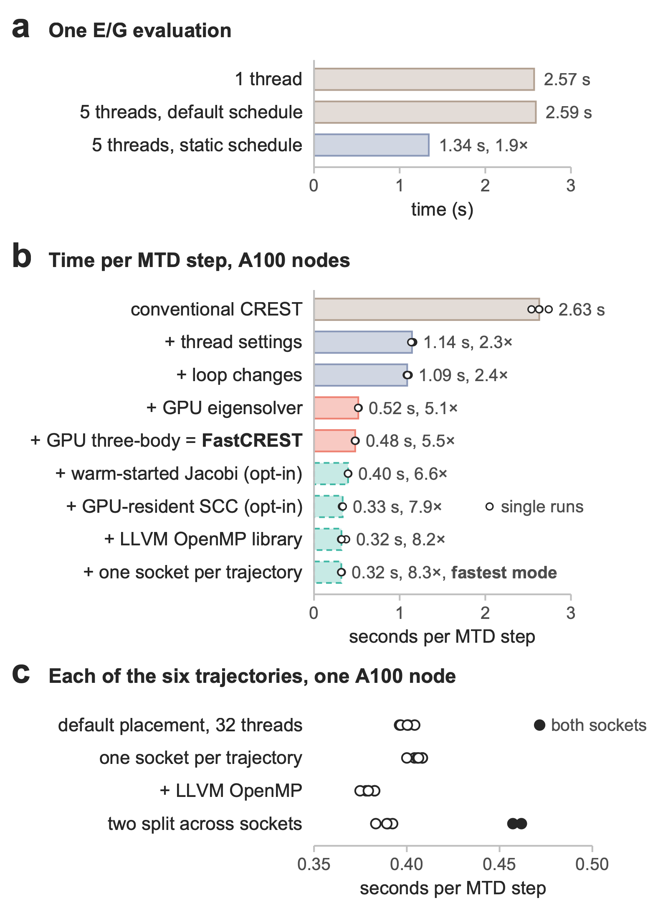
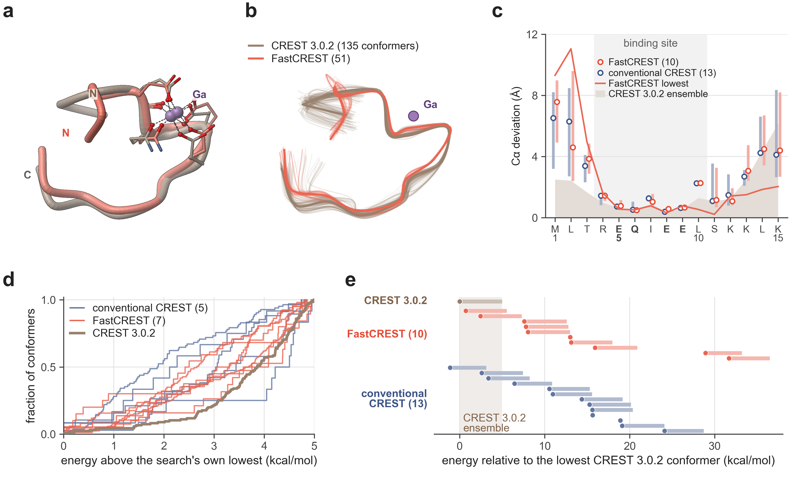

# FastCREST: GPU-Accelerated CREST Conformer Searches with Unchanged Energies and Gradients

Supantha Dey<sup>1,2</sup>, Nilusha Kariyawasam<sup>1</sup> and Ratul Chowdhury<sup>1,\*</sup>

<sup>1</sup> Department of Chemical and Biological Engineering, Iowa State University, Ames, Iowa 50011, United States  
<sup>2</sup> Interdepartmental Genetics and Genomics Program, Iowa State University, Ames, Iowa 50011, United States  
<sup>\*</sup> Corresponding author: [ratul@iastate.edu](mailto:ratul@iastate.edu)

*Manuscript in preparation for the Journal of Chemical Theory and Computation. Markdown version of the PDF; figures as PNG.*

## Abstract

CREST conformer searches with GFN2-xTB take days for large, flexible molecules: one search of a 274-atom gallium(III)–peptide complex with CREST 3.0.2 took 321.5 h on 32 CPU threads. FastCREST keeps CREST’s algorithm and parameters and changes only how a search uses the hardware. Its metadynamics (MTD) and molecular dynamics (MD) trajectories run with tuned OpenMP settings and one GPU, which solves the self-consistent-charge (SCC) eigenproblem and evaluates the three-body dispersion term. About 15,000 geometry optimizations per iteration run as Slurm array jobs on other CPU nodes, and checkpoints let a search continue on preemptible GPUs. On one A100 node, the thread settings and loop changes made an MTD step 2.4 times faster and the GPU another 2.3 times; array jobs cut a batch of optimizations from about 22 h to 34 min. For six more molecules of 24 to 339 atoms, a FastCREST step was 2.2 to 7.1 times faster than a conventional CREST step, increasing with size. A complete FastCREST search took 54.3 h on different hardware, evaluating energies and gradients 8.1 times as fast as the CREST 3.0.2 search with fewer CPU-hours per evaluation. Two opt-in settings (a warm-started Jacobi eigensolver and GPU-resident SCC iterations) and LLVM’s OpenMP library raised the per-step speedup for the test system to 8.3. Energies agree with CREST 3.0.2 within 1.0 × 10⁻¹⁰ Eₕ and gradients within 8.2 × 10⁻¹¹ Eₕ bohr⁻¹, and controlled MD runs passed a prespecified equivalence test. Replicate FastCREST and conventional CREST searches ended in similar compact conformers, with no detectable difference in energy.

## 1. Introduction

CREST with the GFN2-xTB tight-binding method is a standard tool for generating conformer ensembles.<sup>1–3</sup> Its iMTD-GC workflow (iterative metadynamics with genetic crossing)<sup>1,4</sup> runs metadynamics (MTD)<sup>5</sup> trajectories biased by the root-mean-square deviation (RMSD) from earlier structures, optimizes thousands of their snapshots, and repeats until no lower conformer appears. One energy-and-gradient (E/G) evaluation takes a few seconds on one CPU core for a few hundred atoms, but a search needs millions of them. For a 274-atom gallium(III)–peptide complex in implicit water, one search with the CREST 3.0.2 release took 321.5 h (13.4 days) on 32 CPU threads, and more threads hardly help: even with the thread settings of Section 2.2, 64 threads instead of 32 made an MTD time step only 6 to 9% faster.

A CREST search mixes a few long trajectories, whose speed is set by the time of one E/G evaluation, with many thousands of independent geometry optimizations, and CREST runs both on the cores of one node. GPU implementations of semiempirical and tight-binding methods<sup>6–10</sup> speed up single calculations on large systems, but not this mix of short, sequential trajectory steps and many small independent jobs.

FastCREST changes how a search uses the hardware and leaves the computation unchanged (Figure 1). The trajectories run with OpenMP settings that let their threads share the work, and with one GPU for the eigensolver and the three-body dispersion term. The optimizations run as Slurm array jobs on other CPU nodes, and checkpoints let a search run on preemptible GPUs of a shared cluster. We allowed only changes that keep the computation the same up to the order of floating-point operations and the convergence threshold of the self-consistent-charge (SCC) procedure.

## 2. Methods

### 2.1. Conformer Search and Test System

In CREST’s iMTD-GC workflow (Figure 1a), each iteration runs six MTD trajectories at once and optimizes their roughly 15,000 snapshots, first with crude and then with regular thresholds, sorting the results with CREST’s ensemble tool CREGEN. Iterations repeat while they find a new lowest conformer. An MD stage at 400 and 500 K then samples from the lowest conformers; if its optimized snapshots contain a lower conformer, a new cycle of MTD iterations starts. Genetic crossing (GC) and a final optimization end the search, and the ensemble keeps the conformers within 5 kcal/mol of the lowest (the window set by `--quick`).


**Figure 1.** How conventional CREST and FastCREST run the same iMTD-GC search. (a) Conventional CREST runs every stage on the threads of one CPU node; times from the CREST 3.0.2 search. (b) FastCREST runs the trajectories in a main job with one GPU (red) and checkpoints, and the optimizations as Slurm array jobs on other CPU nodes (cyan); times from the FastCREST search of Table 1 (crude batch from the search with the GPU eigensolver only). (c) One time step of one MTD trajectory: work on its five CPU threads (blue) and on its CUDA stream (red); the SCC loop runs 8.55 times per step on average. Green, dashed: the opt-in settings (Sections 2.4 and 2.5).

The test system is a 15-residue peptide (MLTREQIEELSKKLK) in which Ga³⁺ binds five oxygens: the backbone carbonyl oxygen and one carboxylate oxygen of Glu5, the side-chain amide oxygen of Gln6, and one carboxylate oxygen each of Glu8 and Glu9 (274 atoms, charge +4). All searches used GFN2-xTB,<sup>3</sup> ALPB implicit water<sup>11</sup> and `--quick`, and started from the same helical structure. For comparison we use one complete search with the CREST 3.0.2 release<sup>12</sup> on 32 threads with default OpenMP settings, run earlier by one of us (N.K.) for another study on an unrecorded node type; it spent 48.2% of its 321.5 h in MTD, 36.7% in optimizations and 15.0% in MD. We call it the CREST 3.0.2 search.

FastCREST is built from CREST commit cfdc301f,<sup>13</sup> 80 commits after the 3.0.2 release, with tblite 0.5.0<sup>14</sup> and the patches described below. Only one of those commits can change results: unconverged optimizations with CREST’s geometry optimizer (ANCOPT) now stop after 200 cycles. This left 2 to 3 more of every 100 MD snapshots unconverged than the release, more than our limit of 1 per 100 (Table 2). We kept the commit, because structures that converged in both versions passed or failed CREST’s topology check alike, and controlled MD against the release passed (Section 3.3). Conventional CREST means CREST without our GPU code: the CREST 3.0.2 search, and replicate searches with CREST built from the same commit without our patches or with FastCREST’s GPU code switched off, which give bitwise identical single-thread results. All replicate searches used the thread settings of Section 2.2, and most the distributed optimizations of Section 2.6; neither changes the computation.

### 2.2. Thread Settings and Loop Changes

CREST runs the six trajectories of an MTD iteration at once, with five threads each in nested OpenMP parallel regions,<sup>15</sup> and each optimization on one thread. The parallel loops of tblite take their schedule from the environment, and with default settings the GNU OpenMP library hands out one loop iteration at a time. Five threads then computed an E/G evaluation no faster than one (2.59 against 2.57 s), but in 1.34 s with a static schedule (Figure 2a). FastCREST’s environment script sets a static schedule, pins the threads of each trajectory to neighboring cores and enlarges the thread-stack cache of the C library, which cut the cost of entering a nested parallel region from 961 to 304 μs. With the same binary, MTD steps then ran 2.2 to 2.3 times faster than with the settings of the CREST 3.0.2 search, on two A100 nodes and on CPU-only AMD EPYC 7502 nodes, where MD steps ran 2.0 to 2.5 times faster; optimizations did not change. We also replaced 43 uses of the Fortran intrinsic `spread` in tblite and its dependencies, which allocate a temporary array inside inner loops, with explicit loops in the same operand order; compiled without fused multiply–add, they round exactly as before.

Two further run-time settings change only the threading library and where the threads run. The GNU OpenMP library starts the threads of a nested team at every parallel region; LLVM’s library (libomp 20.1.8), loaded in its place without recompiling, keeps them alive between regions. Single points agreed with those under the GNU library within the differences between repeated multithreaded runs (1.7 × 10⁻¹³ Eₕ). When the cores of a job are split unevenly between the two sockets of a node, as in all our per-step measurements, the five cores of one trajectory can span both sockets; that trajectory then ran 5 to 16% slower than the others (Figure 2c), and every MTD iteration waits for it. Requesting 34 cores, which always include six groups of five cores on one socket, and binding each trajectory to one group (30 threads) removed the slow trajectory.



**Figure 2.** Where the speed per MTD step comes from. (a) Time of one E/G evaluation of the test system on an AMD EPYC 7502 node with one thread, and with five threads under the default and a static OpenMP schedule, with the factor relative to the default schedule. (b) Time per MTD step as each change is added, with the factor relative to conventional CREST, on two A100 nodes (AMD EPYC 7543 hosts): median of four runs, two per node (bars), and the single runs (dots; one LLVM OpenMP run was slowed by other work on its node). All rows but the last used 32 of the job’s 34 cores, the last 30 (one socket per trajectory). Dashed: opt-in settings. (c) Time per MTD step of each of the six trajectories (mean of two runs) with the Jacobi eigensolver, in a job with 16 and 24 cores on the two sockets: default thread placement, with one trajectory on both sockets (filled); one socket per trajectory, also with LLVM’s OpenMP library; and a control with two trajectories on both sockets.

### 2.3. GPU Eigensolver and Three-Body Dispersion

Each SCC iteration solves the generalized eigenproblem

```math
\mathbf{H}[\mathbf{P}]\,\mathbf{C} = \mathbf{S}\,\mathbf{C}\,\boldsymbol{\varepsilon}, \qquad \mathbf{P} = \mathbf{C}\,\mathrm{diag}(\mathbf{n})\,\mathbf{C}^{\mathsf{T}}, \tag{1}
```

where the Hamiltonian **H** depends on the density matrix **P**, **S** is the overlap matrix, **C** holds the orbital coefficients, **ε** the orbital energies and **n** the Fermi-smeared occupations. For the test system the matrices are 671 × 671, and a time step takes 8.55 SCC iterations on average. During MTD and MD, FastCREST solves eq 1 with the double-precision `dsygvd` routine of cuSOLVER<sup>16</sup> and forms **P** with cuBLAS,<sup>17</sup> with one CUDA stream per trajectory (Figure 1c). A solve that does not converge on the GPU is repeated on the CPU with the LAPACK routine of conventional CREST. A deterministic double-precision GPU kernel evaluates the three-body (Axilrod–Teller–Muto) term of the D4 dispersion correction,<sup>18–20</sup>

```math
\begin{gathered}
E^{(3)} = \sum_{A<B<C} C_9^{ABC}\, f_\mathrm{damp}\,
\frac{3\cos\theta_A\cos\theta_B\cos\theta_C + 1}{(r_{AB}\,r_{BC}\,r_{CA})^3}, \\
C_9^{ABC} = 5\,\bigl(C_6^{AB} C_6^{BC} C_6^{CA}\bigr)^{1/2},
\end{gathered} \tag{2}
```

with interatomic distances *r*, the interior angles θ of each atom triangle, C₆ coefficients at zero charge, and the GFN2-xTB damping function f<sub>damp</sub>.<sup>3</sup> The kernel runs once per E/G evaluation over up to 3.4 million atom triples and reproduces the CPU gradient within 4.4 × 10⁻¹⁸ Eₕ bohr⁻¹. Optimizations stay on the CPU: 32 optimizations sharing one GPU ran at only 0.87 to 0.89 times the rate on CPU cores, and CPU results can be checked bit for bit.

### 2.4. Optional Warm-Started Jacobi Eigensolver

Within one E/G evaluation, **S** is fixed and **H** changes little from one SCC iteration to the next. An opt-in setting therefore factorizes **S** (Cholesky) once per evaluation and solves the resulting standard eigenproblem with the Jacobi solver of cuSOLVER (`syevj`), started from the eigenvectors of the previous SCC iteration (Figure 1c); in the per-step measurements of Section 3.1, a solve took 2.8 Jacobi sweeps on average. Single-point energies agreed with those of the standard solver within 1.1 × 10⁻¹³ Eₕ and eigenvalues within 7.6 × 10⁻¹⁵ Eₕ, and none of 133,158 solves had to fall back to the standard solver. The setting is off by default, because it was tested only on A100 GPUs and its gain depends on the size of the molecule (Table 3).

### 2.5. Optional GPU-Resident SCC Iterations

In each SCC iteration of the GPU route above, the CPU builds **H**, the GPU solves eq 1, and **C** and **P** return to the CPU, which computes from **P** the Mulliken charges, the atomic dipole and quadrupole moments and the band energy; for the test system about 18 MB cross between CPU and GPU per iteration. A second opt-in setting keeps the iteration on the GPU (Figure 1c). The core Hamiltonian, the overlap and the dipole and quadrupole integrals are copied to the GPU once per E/G evaluation. In each iteration the CPU then sends only the potential shifts; the GPU builds **H** and solves eq 1; the CPU sets the Fermi occupations; and the GPU forms **P** and returns eleven sums per basis function, from which the CPU assembles the charges, moments and energy. Charge mixing and all interaction potentials stay on the CPU, and **C** and **P** are copied back once, after the last iteration, for the gradient. An E/G evaluation then moves 48 instead of 154 MB. The GPU kernels use the formulas of tblite with the same operation order within each matrix element; only the sums over basis functions run in a different order. On the 306 structures of the single-point test (Section 2.8), energies agreed with those of the standard GPU route within 3.4 × 10⁻¹³ Eₕ and gradients within 5 × 10⁻¹⁵ Eₕ bohr⁻¹ (with the Jacobi solver, 2.8 × 10⁻¹³ Eₕ from the Jacobi solver alone), as closely as the GPU and CPU routes agree with each other. The setting works with both eigensolvers; open-shell calculations keep the standard GPU route.

### 2.6. Distributed Optimizations and Checkpoints

The main job, which runs the trajectories on one GPU node, sends each batch of 128 or more optimizations to one Slurm job array<sup>21</sup> in chunks of 64 structures, and the array jobs run the same binary on other CPU nodes (Figure 1b). Before merging, the main job reoptimizes up to 32 structures from array jobs with its own CPU model, which must agree bitwise, and up to 32 from array jobs with other CPU models, which must agree within 10⁻⁷ Eₕ in energy and 10⁻⁴ Å in coordinates; any mismatch reruns the batch or the affected chunks. Each trajectory writes an exact checkpoint every 40 steps and each optimized structure is recorded, so a search stopped during its MTD iterations resumes from its last checkpoint; an interrupted MD stage restarts from its beginning. With checkpoints on, each trajectory starts its first SCC procedure from a fresh guess, the only change in behavior apart from the order of floating-point operations. We did not test whether resumed searches are statistically equivalent to uninterrupted ones.

### 2.7. Performance Measures

Searches adapt their length, so we compare the E/G throughput *R* = *N*/t<sub>wall</sub> and the allocated cost per evaluation,

```math
K_\mathrm{CPU} = \frac{1}{N}\sum_j c_j t_j, \qquad K_\mathrm{GPU} = \frac{1}{N}\sum_j g_j t_j, \tag{3}
```

where *N* counts the E/G evaluations of the main job and all array jobs, t<sub>wall</sub> is the elapsed time of the main job, and job *j* was allocated c<sub>j</sub> hardware threads and g<sub>j</sub> GPUs for its elapsed time t<sub>j</sub>. Times per MTD step come from one batch of six MTD trajectories of 400 steps for each configuration, run on one node in the order of Figure 2b and then in reverse.

### 2.8. Tests of the Computation

We compared single points of FastCREST with those of the release and of CREST built without our patches on 306 structures, and the GPU code path with the CPU one. Trajectories cannot be compared bit for bit, because multithreaded sums are not reproducible:<sup>22</sup> even two runs of the same binary separated by 0.5 Å (all-atom RMSD) after a median of 6.5 ps. We therefore ran controlled MD, 20 ps from four starting structures at 400 and 500 K with identical initial velocities, and compared the fraction of frames whose bonding topology changed. Two configurations count as equivalent if the paired 90% confidence interval of the mean difference over 24 or 44 trajectory pairs lies within ±0.15 (two one-sided tests<sup>23</sup>). Whole searches are not reproducible either, so we compared groups of replicate searches at a point that every search reaches, the lowest crude-level energy after its first MTD iteration, with the Hodges–Lehmann shift and its exact confidence interval.<sup>24,25</sup> All criteria were fixed before the runs, except the rule for the replicate comparison, which was fixed after some individual results had been seen but before any group statistic was computed.

## 3. Results and Discussion

### 3.1. Time per MTD Step

Figure 2b adds the changes one at a time on two A100 nodes (AMD EPYC 7543 hosts). Conventional CREST took 2.63 s per MTD step there (2.8 s in the CREST 3.0.2 search). The thread settings and loop changes cut this to 1.09 s, a factor of 2.4, and the GPU eigensolver and three-body term to 0.48 s, another factor of 2.3, so a FastCREST step was 5.5 times faster on the same nodes. The Jacobi eigensolver reached 0.40 s. The GPU-resident SCC iterations reached 0.42 s alone and 0.33 s with the Jacobi solver, and LLVM’s OpenMP library 0.32 s. In this fastest mode a step was 8.3 times faster than with conventional CREST and 1.5 times faster than with FastCREST. With the GPU-resident SCC, the trajectory whose cores span both sockets was only about 5% slower than the others (22% with the Jacobi solver alone), so one socket per trajectory changed the mean step little (1.01 times); without it, one socket per trajectory made the slowest trajectory, which sets the pace of an MTD iteration, 1.15 times faster (Figure 2c).

Each step is still mostly CPU work (63.5% in a profile of an earlier version), and six trajectories kept the GPU 83 to 87% busy in FastCREST and 79 to 87% in the fastest mode. A second GPU per search therefore gained only a factor of 1.2, and two searches sharing one GPU and the 32 cores raised the combined output by at most a factor of 1.12, while each ran 1.6 to 1.9 times slower.

We repeated the measurement of Figure 2b for six more closed-shell molecules of 24 to 339 atoms, on one A100 node of the same type (Table 3). The thread settings made a step 2.1 to 3.0 times faster for every molecule. The GPU eigensolver gained more as the molecule grew, from a factor of 1.05 for caffeine to 2.8 for a 16-unit amylose chain, so a FastCREST step was 2.2 to 7.1 times faster than with conventional CREST. The Jacobi solver added a factor of 1.2 to 1.3 for the medium-sized molecules but only 1.02 and 1.09 for the smallest and the largest. LLVM’s OpenMP library helped most for the smallest molecule, caffeine (a factor of 3.1). In the fastest mode a step was 6.9 to 11.7 times faster than with conventional CREST.

### 3.2. Complete Searches

Table 1 lists the complete searches. The FastCREST search found a lower conformer twice, so it ran three cycles instead of two and made 1.37 times as many E/G evaluations as the CREST 3.0.2 search. It took 54.3 h, so its throughput was 8.1 times higher (R/R₀ = 8.1). Per million evaluations it was allocated 1,231 CPU-hours plus 7.5 GPU-hours, against at least 1,939 CPU-hours, so it is cheaper whenever a GPU-hour costs less than about 94 hardware-thread-hours (47 core-hours). Optimizations fell from 36.7% to 13.6% of the run time, so the trajectories now take 86% of it. Without a GPU, searches with the thread settings, two of them also with distributed optimizations, reached 3.3 to 4.7 times the throughput of the CREST 3.0.2 search, and with the warm-started Jacobi eigensolver three FastCREST searches reached 9.5, 10.0 and 9.5 times. Two searches in the fastest mode reached 12.4 and 12.7 times and were allocated 1,195 and 1,170 CPU-hours plus 4.9 and 4.8 GPU-hours per million evaluations.

**Table 1.** Complete Searches of the Test System

| search | hardware | MTD/MD | wall (h) | *N* (10⁶) | times faster | K<sub>CPU</sub> | K<sub>GPU</sub> |
|:---|:---|:---|:---|:---|:---|:---|:---|
| CREST 3.0.2<sup>*a*</sup> | not recorded | 4/2 | 321.5 | 5.31 | 1.00× | 1,939 | 0 |
| CPU, one node<sup>*b*</sup> | Zen 4, 64 cores | 4/2 | 100.3 | 5.50 | 3.32× | 2,334 | 0 |
| CPU, distributed<sup>*c*</sup> | Zen 4 | 4/3 | 98.7 | 6.17 | 3.79× | 2,851 | 0 |
| FastCREST, GPU off<sup>*d*</sup> | Zen 5 | 2/1 | 33.8 | 2.62 | 4.71× | 2,255 | 0 |
| GPU eigensolver only<sup>*e*</sup> | A100/EPYC 7502 | 4/2 | 52.0 | 5.38 | 6.28× | 1,574 | 9.7 |
| **FastCREST**<sup>*f*</sup> | A100/EPYC 7543 | 5/3 | 54.3 | 7.26 | 8.11× | 1,231 | 7.5 |
| FastCREST + Jacobi, search 1<sup>*g*</sup> | A100/EPYC 7543 | 4/3 | 36.9 | 5.77 | 9.48× | 1,194 | 6.4 |
| FastCREST + Jacobi, search 2<sup>*g*</sup> | A100/EPYC 7543 | 3/2 | 28.4 | 4.69 | 9.99× | 1,228 | 6.1 |
| FastCREST + Jacobi, search 3<sup>*g*</sup> | A100/EPYC 7543 | 4/2 | 36.8 | 5.74 | 9.46× | 1,315 | 6.4 |
| Fastest mode, search 1<sup>*h*</sup> | A100/EPYC 7543 | 5/3 | 35.2 | 7.17 | 12.36× | 1,195 | 4.9 |
| Fastest mode, search 2<sup>*h*</sup> | A100/EPYC 7543 | 6/4 | 42.7 | 8.97 | 12.73× | 1,170 | 4.8 |

One search per row, from the same input and settings: MTD iterations and MD stages, elapsed time of the main job, E/G evaluations *N*, how many times faster than the CREST 3.0.2 search in E/G evaluations per hour (R/R₀; the searches ran different numbers of iterations, so their wall times are not comparable), and allocated CPU- and GPU-hours per million evaluations (K<sub>CPU</sub>, K<sub>GPU</sub>; eq 3). Hardware: GPU and host CPU of the main job (AMD CPUs). All but the first two searches ran their optimizations as Slurm array jobs on other nodes. <sup>*a*</sup>Release version with default OpenMP settings; CPU-hours are 32 threads × wall time, not a recorded allocation. <sup>*b*</sup>Thread settings and loop changes, no GPU. <sup>*c*</sup>Thread settings, distributed optimizations and checkpoints, without the loop changes. <sup>*d*</sup>One cycle; counted among the conventional CREST replicates. <sup>*e*</sup>Earlier version: no loop changes, three-body term on the CPU. <sup>*f*</sup>The default changes of Sections 2.2, 2.3 and 2.6. <sup>*g*</sup>With the warm-started Jacobi eigensolver (Section 2.4). <sup>*h*</sup>Both opt-in settings (Sections 2.4 and 2.5), LLVM’s OpenMP library and one socket per trajectory (30 threads). EPYC 7502 is a Zen 2 CPU, EPYC 7543 a Zen 3 CPU.

### 3.3. Same Computation

Table 2 summarizes the tests. Single points on 306 structures agreed with the release within 1.01 × 10⁻¹⁰ Eₕ in energy and 8.2 × 10⁻¹¹ Eₕ bohr⁻¹ in gradient, two orders of magnitude inside our criterion, and the GPU and CPU code paths of FastCREST, including both opt-in settings, differed by at most 4.6 × 10⁻¹³ Eₕ. All 13 controlled MD comparisons, six of them with one or both opt-in settings, passed the equivalence test.

Replicate searches scatter widely in both codes. Thirteen of the 15 finished conventional CREST replicates ended between −1.1 and +24.1 kcal/mol relative to the lowest conformer of the CREST 3.0.2 search; the other two ended more than 110 kcal/mol higher because of a fallback in CREST itself (Section 3.4). After the first MTD iteration, no difference between FastCREST and conventional CREST was detected: the lowest energies of the 16 FastCREST searches were typically 4.1 kcal/mol higher than those of the 17 conventional CREST searches (Hodges–Lehmann shift; 95% confidence interval −4.9 to +11.8 kcal/mol). A FastCREST disadvantage of up to 11.8 kcal/mol cannot be excluded, and showing equivalence within ±2 kcal/mol would need more than a hundred searches per group. Final energies agree with this (medians: FastCREST +10.5, conventional CREST +15.3 kcal/mol; post hoc shift −2.7 kcal/mol, 95% confidence interval −11.3 to +6.5). The evidence that the computation is unchanged therefore rests on the code-level tests.

**Table 2.** Tests of the Computation

| test | compared | criterion | result |
|:---|:---|:---|:---|
| search setup | eight configurations | same parameters | same (flexibility measure 0.391, six MTD trajectories of 250 ps, 272 SHAKE constraints<sup>26</sup>) |
| single points | 306 structures, nine configurations | largest \|ΔE\| ≤ 10⁻⁸ Eₕ, largest gradient difference ≤ 10⁻⁶ Eₕ bohr⁻¹ | 1.01 × 10⁻¹⁰ Eₕ and 8.2 × 10⁻¹¹ Eₕ bohr⁻¹ from the release |
| optimizer cycle limit (CREST change after 3.0.2) | 200 MD snapshots, our builds against the release | at most 1 more unconverged per 100 | 2 to 3 more per 100: limit exceeded; change kept (Section 2.1) |
| controlled MD | 13 comparisons of 24 or 44 trajectory pairs | 90% confidence interval of the mean difference within ±0.15 | all 13 equivalent, in raw frames and after optimization |
| replicate searches | lowest energy after the first MTD iteration, 16 FastCREST and 17 conventional CREST searches | difference: 95% interval excludes 0; equivalence: 90% interval within ±2 kcal/mol | inconclusive: shift +4.1 kcal/mol, 95% interval −4.9 to +11.8 |
| released code | clean clone, rebuilt | byte-identical output; test script passes | byte-identical; 16 of 16 tests passed |

**Table 3.** Time per MTD Step for Molecules of Different Size

| molecule | atoms | charge | conventional CREST (s per step) | FastCREST (times faster than conventional CREST) | \+ Jacobi (times faster than conventional CREST) | fastest mode (times faster than conventional CREST) |
|:---|:---|:---|:---|:---|:---|:---|
| caffeine | 24 | 0 | 0.165 | 2.2× | 2.2× | 11.7× |
| taxol | 113 | 0 | 0.581 | 3.1× | 4.1× | 7.0× |
| Ga(III)–peptide | 132 | +3 | 0.782 | 3.5× | 4.6× | 6.9× |
| Ga(III)–peptide | 174 | −5 | 1.575 | 5.2× | 6.8× | 9.5× |
| Ga(III)–peptide | 236 | −8 | 2.358 | 5.2× | 6.4× | 7.8× |
| test system<sup>*a*</sup> | 274 | +4 | 2.630 | 5.5× | 6.6× | 8.3× |
| amylose, 16 units | 339 | 0 | 3.948 | 7.1× | 7.7× | 9.0× |

Time per MTD step with conventional CREST, and how many times faster FastCREST, FastCREST with the Jacobi eigensolver and the fastest mode were. One job per molecule on an A100 node with an AMD EPYC 7543 host, mean of two runs per setting, as in Figure 2b. All molecules closed shell; GFN2-xTB, ALPB water, `--quick`. <sup>*a*</sup>Median of the four runs of Figure 2b.

### 3.4. Final Structures and Energies

CREST’s topology check keeps only structures with the bonds of the input, so every final conformer keeps the five Ga–O bonds, and the searches differ mainly in the rest of the peptide. The CREST 3.0.2 search ended 136.2 kcal/mol below the input, in a compact conformer (radius of gyration 6.33 instead of 7.56 Å) in which the helix has unfolded and the second carboxylate oxygen of Glu8 sits 2.40 Å from Ga, a contact that the topology check does not count as a bond. These energies and the preference for compact folds are GFN2-xTB/ALPB results that we did not validate further.

Of the 27 finished searches (the CREST 3.0.2 search, 10 FastCREST and 15 conventional CREST replicates, and one with the Jacobi option), all but two conventional CREST replicates ended compact. In those two, the regular optimization of one MTD iteration changed the bonding topology of every structure in the energy window, and CREGEN fell back to the helical input (CREST code that is the same in the 3.0.2 release). The lowest FastCREST conformer (best of ten searches) lies 0.7 kcal/mol above the lowest conformer of the CREST 3.0.2 search and has the same Glu8 contact (2.33 Å). Superposed on the binding site<sup>27</sup> (Figure 3a), the two coincide within 2.1 Å from Arg4 to Lys15; only Met1 to Thr3 point elsewhere, and the two final ensembles overlap in the same way (Figure 3b). No other search found the lowest CREST 3.0.2 conformer: the lowest conformers of the other compact searches lie 1.4 to 4.1 Å (backbone RMSD) from it, whereas all 135 conformers of the CREST 3.0.2 search lie within 1.4 Å. FastCREST and conventional CREST replicates deviate from it in the same places (Figure 3c): their median Cα deviations agree within 0.5 Å at every residue except Met1 and Leu2.

Ensemble sizes vary widely (FastCREST 1 to 173 conformers, conventional CREST 1 to 82, CREST 3.0.2 search 135), because each search keeps only the conformers of its last cycle within 5 kcal/mol of its own lowest. Within that window, FastCREST and conventional CREST ensembles distribute their conformers alike, and the CREST 3.0.2 ensemble, with most conformers 3 to 5 kcal/mol above its lowest, lies at the edge of both (Figure 3d). On one energy scale, FastCREST searches scatter as widely as conventional CREST ones (lowest conformers +0.7 to +31.7 against −1.1 to +24.1 kcal/mol), and only 2 of the 10 FastCREST and 3 of the 13 conventional CREST ensembles overlap the energy range of the CREST 3.0.2 ensemble (Figure 3e).



**Figure 3.** Final conformers of the CREST 3.0.2 search (brown) and of the replicate FastCREST (red) and conventional CREST searches (blue); numbers in parentheses count searches. (a–c) Structures superposed on the binding site (Ga, Cδ of Glu5, Gln6, Glu8 and Glu9, and the backbone of residues 4–10). (a) Lowest conformers (FastCREST: best of ten searches, 0.7 kcal/mol above the CREST 3.0.2 one); tubes trace the Cα atoms, and dashes join Ga to oxygens within 2.6 Å. (b) Cα traces of all final conformers, the lowest in bold. (c) Deviation of each residue’s Cα from the lowest CREST 3.0.2 conformer, for the lowest conformer of each compact search: medians (circles) and interquartile ranges (bars), the FastCREST conformer of (a) (line), and the largest deviation within the CREST 3.0.2 ensemble (shaded). Bold residues bind Ga. (d) Cumulative fraction of conformers against the energy above the search’s own lowest conformer, for ensembles with at least 10 conformers. (e) One row per compact search: its lowest conformer (dot) and the energy range of its final conformers (bar), relative to the lowest CREST 3.0.2 conformer; shading marks the CREST 3.0.2 ensemble. Two conventional CREST searches that ended at the helical start (+115 and +124 kcal/mol) are not shown.

### 3.5. Limitations

The complete searches and the tests of the computation come from one system with `--quick`. Per MTD step, the gains depended on the size of the molecule (Table 3) and will also depend on the CPU and the GPU. Most configurations in Table 1 ran one complete search, on different hardware, and the replicate groups ran under different conditions. Of 40 FastCREST replicate searches started, 16 completed their first MTD iteration: a memory error on one GPU stopped 17 of them when they resumed, and having seen interim results we did not restart them; the other 7 were canceled early or still queued. Thirteen of these 16 FastCREST searches, but 7 of the 17 conventional CREST ones, resumed from checkpoints during their first iteration; 12 of the 16 finished it on L40S or V100 GPUs, which the code-level tests did not cover, and 6 computed the three-body term on the CPU for part of the run. Resuming in the first MTD iteration of a later cycle failed in four searches, all after their first iteration (fixed in version 1.2.0). In single Cu and Ni searches of a related peptide, most MTD trajectories stopped early with these settings, as they did in Fe searches with the CREST 3.0.2 release; for ten structures of a high-spin Fe(II) complex, FastCREST’s energies and gradients agreed with those of the CREST 3.0.2 release within 9 × 10⁻¹¹ Eₕ and 1.2 × 10⁻¹⁰ Eₕ bohr⁻¹. When CREST finds a lower conformer, it starts the next MTD trajectories from the input structure, not from that conformer, and when this starts a new cycle it also discards the ensemble found so far (the 3.0.2 release does the same). This happened at least once in 25 of the 27 finished searches, in both codes, so a final ensemble can lie above the lowest conformer seen during a search. FastCREST 1.3.0 can fix both (opt-in).

## 4. Conclusions

FastCREST runs CREST’s iMTD-GC searches several times faster on a GPU cluster without changing what is computed. For the 274-atom test system, about half of the gain per MTD step comes from thread settings that any CREST user can apply and half from one GPU for the eigensolver and the three-body dispersion term; the GPU’s share grows with the size of the molecule (Table 3). Running the optimizations as array jobs on other nodes cut their share of the run time from 37 to 14%, so further speedup must come from the MTD step itself. Keeping the SCC iterations on the GPU made a step another 1.2 times faster with the Jacobi solver; the gradient, still computed on the CPU, is the next candidate. Caching the overlap factorization alone, sharing idle threads between trajectories, batching eigensolves in the optimizations, other compiler flags and Intel MKL gave little or no gain, and density-matrix purification would change the algorithm.

## Data and Software Availability

FastCREST is available at <https://github.com/chowdhurylab-studio/fastCREST> (version 1.3.0). It consists of patches to CREST cfdc301f,<sup>13</sup> tblite,<sup>14</sup> dftd4,<sup>28</sup> simple-dftd3,<sup>29</sup> multicharge<sup>30</sup> and mctc-lib,<sup>31</sup> each under the license of the code it patches, with a build script that fetches the pinned upstream commits, the thread-settings script, Slurm job templates and a test script. With FastCREST’s options switched off, single-thread energies and gradients are bitwise identical to those of an unpatched build. A clean build from GitHub reproduced the single-point output of the binary used here byte for byte and passed the test script (Table 2). The input structures, the final ensembles and the raw outputs are available from the authors on request.

## Acknowledgments

We thank Mahbuba Ferdaous for the structures of the open-shell metal complexes of the related peptide and Iowa State University Research IT for access to the Nova cluster. [Funding to be added.] The authors declare no competing financial interest.

## References

1. Pracht, P.; Bohle, F.; Grimme, S. Automated exploration of the low-energy chemical space with fast quantum chemical methods. *Phys. Chem. Chem. Phys.* **2020**, *22*, 7169–7192
2. Pracht, P.; Grimme, S.; Bannwarth, C.; Bohle, F.; Ehlert, S.; Feldmann, G.; Gorges, J.; Müller, M.; Neudecker, T.; Plett, C.; Spicher, S.; Steinbach, P.; Wesołowski, P. A.; Zeller, F. CREST—A program for the exploration of low-energy molecular chemical space. *J. Chem. Phys.* **2024**, *160*, 114110
3. Bannwarth, C.; Ehlert, S.; Grimme, S. GFN2-xTB—An accurate and broadly parametrized self-consistent tight-binding quantum chemical method with multipole electrostatics and density-dependent dispersion contributions. *J. Chem. Theory Comput.* **2019**, *15*, 1652–1671
4. Grimme, S. Exploration of chemical compound, conformer, and reaction space with meta-dynamics simulations based on tight-binding quantum chemical calculations. *J. Chem. Theory Comput.* **2019**, *15*, 2847–2862
5. Laio, A.; Parrinello, M. Escaping free-energy minima. *Proc. Natl. Acad. Sci. U.S.A.* **2002**, *99*, 12562–12566
6. Wu, X.; Koslowski, A.; Thiel, W. Semiempirical quantum chemical calculations accelerated on a hybrid multicore CPU–GPU computing platform. *J. Chem. Theory Comput.* **2012**, *8*, 2272–2281
7. Maia, J. D. C.; Urquiza Carvalho, G. A.; Mangueira, C. P.; Santana, S. R.; Cabral, L. A. F.; Rocha, G. B. GPU linear algebra libraries and GPGPU programming for accelerating MOPAC semiempirical quantum chemistry calculations. *J. Chem. Theory Comput.* **2012**, *8*, 3072–3081
8. Zhou, G.; Nebgen, B.; Lubbers, N.; Malone, W.; Niklasson, A. M. N.; Tretiak, S. Graphics processing unit-accelerated semiempirical Born Oppenheimer molecular dynamics using PyTorch. *J. Chem. Theory Comput.* **2020**, *16*, 4951–4962
9. Vuong, V.-Q.; Cevallos, C.; Hourahine, B.; Aradi, B.; Jakowski, J.; Irle, S.; Camacho, C. Accelerating the density-functional tight-binding method using graphical processing units. *J. Chem. Phys.* **2023**, *158*, 084802
10. Friede, M.; Hölzer, C.; Ehlert, S.; Grimme, S. dxtb—An efficient and fully differentiable framework for extended tight-binding. *J. Chem. Phys.* **2024**, *161*, 062501
11. Ehlert, S.; Stahn, M.; Spicher, S.; Grimme, S. Robust and efficient implicit solvation model for fast semiempirical methods. *J. Chem. Theory Comput.* **2021**, *17*, 4250–4261
12. Pracht, P.; others CREST: Conformer–Rotamer Ensemble Sampling Tool, version 3.0.2. 2024; <https://github.com/crest-lab/crest/releases/tag/v3.0.2>, released Aug 25, 2024; conda-forge build
13. Pracht, P.; others CREST: Conformer–Rotamer Ensemble Sampling Tool, commit cfdc301f. 2026; <https://github.com/crest-lab/crest/tree/cfdc301f759686b0fd66ced63b5ddbd6c693fa4f>, commit of Jun 16, 2026
14. Ehlert, S. tblite: Light-weight tight-binding framework, version 0.5.0. 2025; <https://github.com/tblite/tblite/releases/tag/v0.5.0>, commit 6f6cd7d
15. OpenMP Architecture Review Board OpenMP Application Programming Interface, Version 5.2. 2021; <https://www.openmp.org/specifications/>, accessed Oct 26, 2026
16. NVIDIA Corporation cuSOLVER Library, CUDA Toolkit 12.4.1 Documentation. 2024; <https://docs.nvidia.com/cuda/archive/12.4.1/cusolver/index.html>, accessed Oct 26, 2026
17. NVIDIA Corporation cuBLAS Library, CUDA Toolkit 12.4.1 Documentation. 2024; <https://docs.nvidia.com/cuda/archive/12.4.1/cublas/index.html>, accessed Oct 28, 2026
18. Axilrod, B. M.; Teller, E. Interaction of the van der Waals type between three atoms. *J. Chem. Phys.* **1943**, *11*, 299–300
19. Muto, Y. Force between nonpolar molecules. *Nippon Sugaku-Buturigakkwaishi* **1943**, *17*, 629–631, In Japanese
20. Caldeweyher, E.; Ehlert, S.; Hansen, A.; Neugebauer, H.; Spicher, S.; Bannwarth, C.; Grimme, S. A generally applicable atomic-charge dependent London dispersion correction. *J. Chem. Phys.* **2019**, *150*, 154122
21. Yoo, A. B.; Jette, M. A.; Grondona, M. In *Job Scheduling Strategies for Parallel Processing*; Feitelson, D., Rudolph, L., Schwiegelshohn, U., Eds.; Lecture Notes in Computer Science; Springer: Berlin, Heidelberg, 2003; Vol. 2862; pp 44–60
22. Demmel, J.; Nguyen, H. D. Parallel reproducible summation. *IEEE Trans. Comput.* **2015**, *64*, 2060–2070
23. Schuirmann, D. J. A comparison of the two one-sided tests procedure and the power approach for assessing the equivalence of average bioavailability. *J. Pharmacokinet. Biopharm.* **1987**, *15*, 657–680
24. Hodges, J. L.; Lehmann, E. L. Estimates of location based on rank tests. *Ann. Math. Stat.* **1963**, *34*, 598–611
25. Bauer, D. F. Constructing confidence sets using rank statistics. *J. Am. Stat. Assoc.* **1972**, *67*, 687–690
26. Ryckaert, J.-P.; Ciccotti, G.; Berendsen, H. J. C. Numerical integration of the Cartesian equations of motion of a system with constraints: Molecular dynamics of n-alkanes. *J. Comput. Phys.* **1977**, *23*, 327–341
27. Kabsch, W. A solution for the best rotation to relate two sets of vectors. *Acta Cryst. A* **1976**, *32*, 922–923
28. Caldeweyher, E.; Ehlert, S.; Grimme, S. dftd4: Generally applicable atomic-charge dependent London dispersion correction, version 3.7.0. 2024; <https://github.com/dftd4/dftd4/releases/tag/v3.7.0>
29. Ehlert, S. simple-dftd3: Simple reimplementation of the DFT-D3 method, version 1.2.1. 2024; <https://github.com/dftd3/simple-dftd3/releases/tag/v1.2.1>
30. Ehlert, S. multicharge: Electronegativity equilibration model for atomic partial charges, version 0.3.0. 2024; <https://github.com/grimme-lab/multicharge/releases/tag/v0.3.0>
31. Ehlert, S. mctc-lib: Modular computation tool chain library, version 0.6.1. 2026; <https://github.com/grimme-lab/mctc-lib/releases/tag/v0.6.1>
